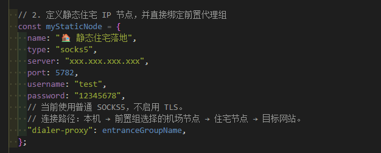
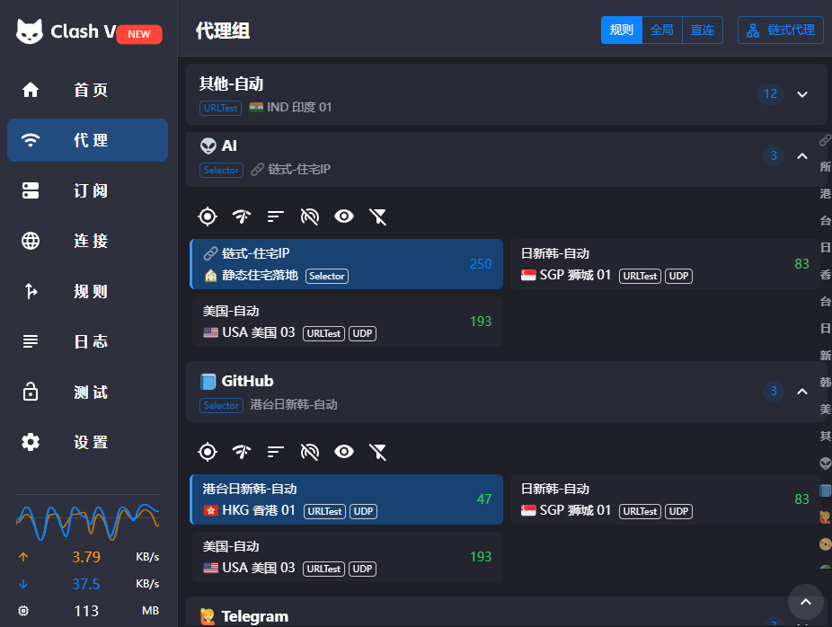

# clash客户端分流规则配置—让你的clash更简单好用！

## clash-verge-rev[下载](https://github.com/clash-verge-rev/clash-verge-rev/releases)

# 说明

## 项目提供原版规则和 .list 规则两种使用方式，每种均有线上、本地两个脚本，四个脚本任选一个使用，不要合并

- 原版：[`script_http.js`](./script_http.js) 使用线上规则，[`script_local.js`](./script_local.js) 使用本地规则，保留原有规则配置和分组。
- `.list` 版：[`script_http_proxy_rules.js`](./script_http_proxy_rules.js) 使用线上 `.list` 规则，[`script_local_proxy_rules.js`](./script_local_proxy_rules.js) 使用本地 `.list` 规则。

建议先试用线上规则，熟练后再使用本地规则自定义属于自己的规则集。

## 打开客户端->点击订阅->右击全局扩展脚本->编辑文件->将项目中的script_xxx文件内容复制到编辑框中，然后点击保存即可

## 若使用线上规则，原版选择 script_http.js，.list 版选择 script_http_proxy_rules.js；保存扩展脚本后由客户端下载规则，不需要手动复制规则文件

## 若使用本地规则，原版选择 script_local.js，.list 版选择 script_local_proxy_rules.js，并按对应方式复制规则文件

- 原版：将项目中的 `ruleset` 目录复制到 Clash 实际配置目录下，保留目录层级，供 `script_local.js` 读取原有五个规则文件。
- `.list` 版：将项目 `ruleset` 目录下的 `ai.list`、`social.list`、`common.list`、`global.list` 复制到 Clash 实际配置目录下的 `ruleset` 目录中。

本地路径以所选脚本中 `ruleProviders` 的 `path` 为准，不能只把规则文件留在项目目录。

# 使用

## 点击代理->规则->按所选脚本选择业务分组的出口；未匹配流量进入 ➡️ 国内组，默认选择 DIRECT

- 原版：AI、GitHub、Telegram、流媒体、国外五个业务分组。
- `.list` 版：AI、社交账号、日常应用、国外四个业务分组。

## 最后右键clash图标打开规则规则模式和TUN模式即可

## 注意：配置完需要重启clash客户端

## script_xxx.js有关键配置注释，可以根据自己的需求自行修改

# 链式代理配置（可选）

## 如果有住宅IP，可以在script_xxx.js中按照下图填写信息，然后选择`🔗 链式-住宅IP`分组，最终链路即本机 → 港台日新韩的机场节点自动选择 → 住宅IP → 目标网站

## 如果没有住宅IP，`🔗 链式-住宅IP`分组会显示Error，选择其他可用自动分组，最终链路即本机 → 对应分组的机场节点自动选择 → 目标网站
